# Decisiones a través de la pirámide (ISA-95)

Veintisiete situaciones de la quesería recorridas del PLC a la gerencia: ocho flujos normales, uno por cada actividad de gestión de operaciones de ISA-95 (parte 3), y diecinueve excepciones ordenadas por su origen. La regla es la misma en todas: **cada nivel resuelve lo que puede en su plazo y sube solo el dato que el nivel de arriba necesita para decidir.** En los diagramas, las flechas son datos entre sistemas y las notas son decisiones de personas. Las tablas de pasos, los diecinueve mensajes entre niveles con su categoría y su verbo de ISA-95, y la frontera entre el ERP y el MES están en el documento [Casos de decisión en la pirámide](../Produccion%20y%20finanzas/Casos_piramide.pdf).

| Nivel | Sistema | Quién decide | Qué decide | Plazo |
|---|---|---|---|---|
| N4 | ERP (SAP Business One) | Gerencia, Ventas, planeación, compras y costos | Qué se vende y se produce, qué se compra, cuánto cuesta y en qué se invierte | Días a meses |
| N3 | MES de la quesería (Ignition con PostgreSQL) | Jefe de quesería, calidad, técnico de mantenimiento | Qué lote va en qué tina y cuándo, qué se libera o se retiene, qué se repara primero | Minutos a un turno |
| N2 | SCADA (Ignition) e historiador | Quesero y operadores | Cómo responder a una alarma: seguir, pasar a manual o retener | Segundos a minutos |
| N1 | PLC-300 (CompactLogix) y controladores de los equipos | Nadie: decide la lógica programada | Parar en estado seguro, mantener los enclavamientos, no dejar avanzar una fase sin sus permisos | Milisegundos |
| N0 | Proceso: instrumentos y actuadores | -- | Medir y actuar | Continuo |

**Flujos normales**

<details>
<summary><b>F1. Alta de un producto y de su receta</b></summary>

**Qué lo dispara:** La cadena firma el contrato de marca propia: hay que crear el doble crema con su empaque y su etiqueta, sin tocar la receta de proceso. **Actividad de ISA-95:** Gestión de definiciones (producción y calidad).

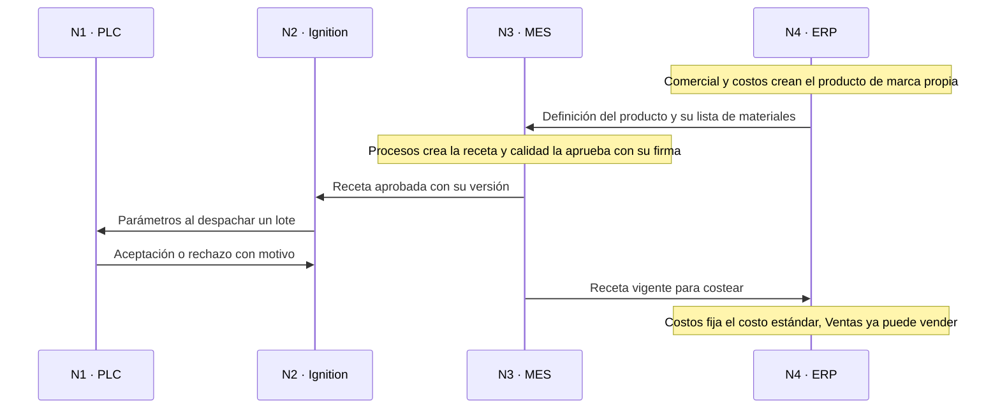

</details>

<details>
<summary><b>F2. Asignación diaria del personal por competencias</b></summary>

**Qué lo dispara:** Antes de cada turno, el MES cruza quién llegó con los puestos que pide el programa del día. **Actividad de ISA-95:** Gestión de recursos (producción).

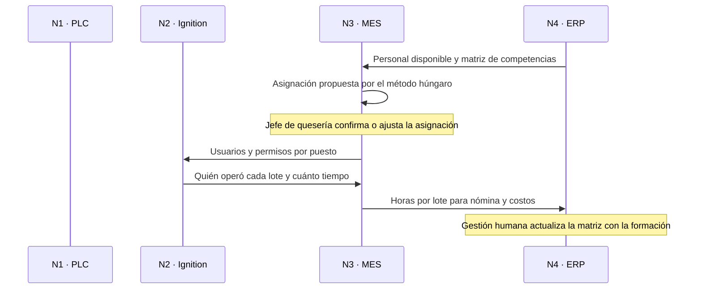

</details>

<details>
<summary><b>F3. Programa del día desde las órdenes del ERP</b></summary>

**Qué lo dispara:** Cada tarde se arma el programa de la quesería para el día siguiente. **Actividad de ISA-95:** Programación detallada (producción).

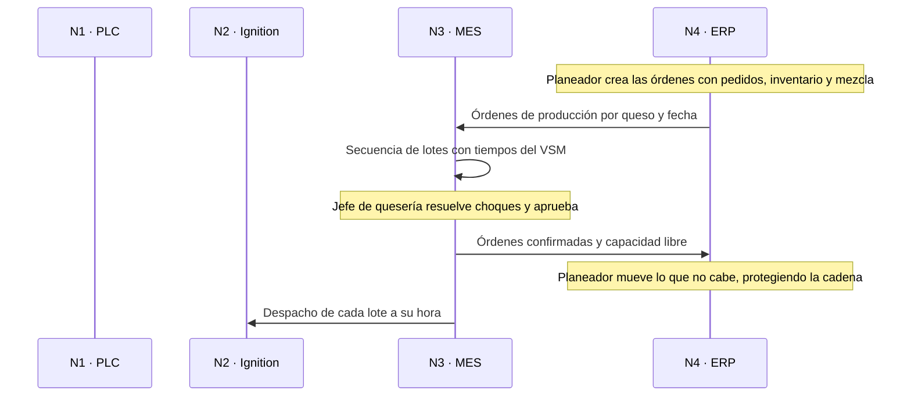

</details>

<details>
<summary><b>F4. Despacho, ejecución y reporte de un lote</b></summary>

**Qué lo dispara:** Llega la hora de un lote del programa aprobado. Es el recorrido normal de la sección 8 del README, aquí con las decisiones de cada nivel. **Actividad de ISA-95:** Despacho, gestión de la ejecución, recolección de datos y seguimiento (producción).

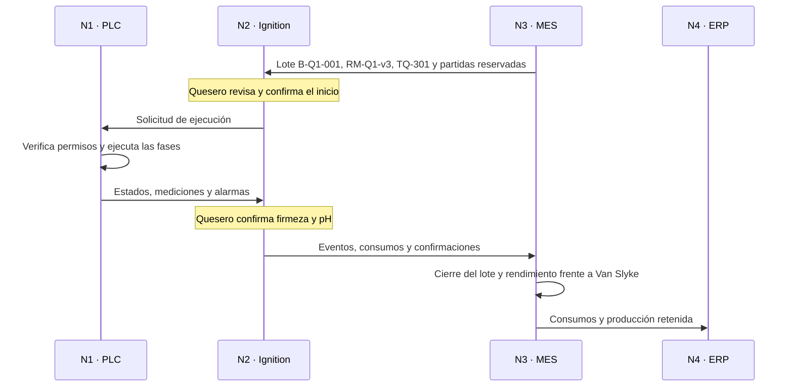

</details>

<details>
<summary><b>F5. Muestreo y liberación de un lote</b></summary>

**Qué lo dispara:** Se cierra un lote: el MES pide sus muestras según el plan de muestreo. **Actividad de ISA-95:** Gestión de la ejecución y seguimiento (calidad).

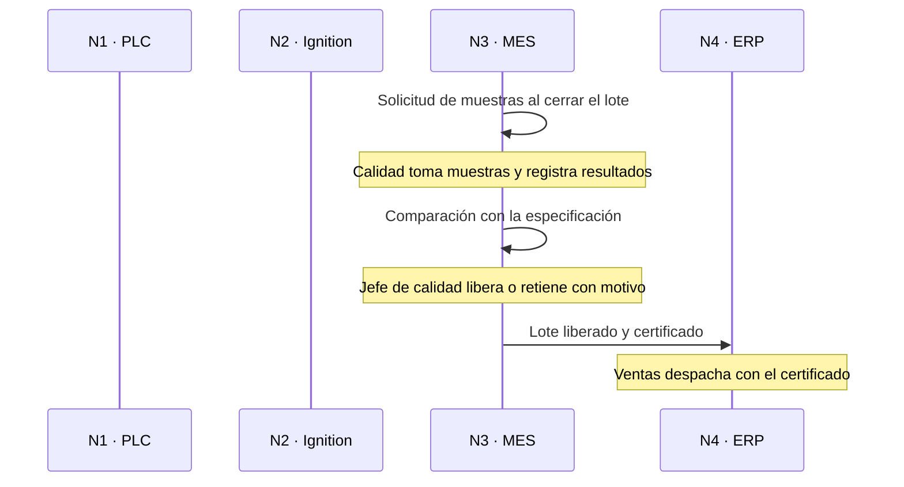

</details>

<details>
<summary><b>F6. Mantenimiento preventivo programado</b></summary>

**Qué lo dispara:** La bomba P-301 llega a 2.000 horas de operación y le toca el cambio de sellos. **Actividad de ISA-95:** Programación detallada, despacho y ejecución (mantenimiento).

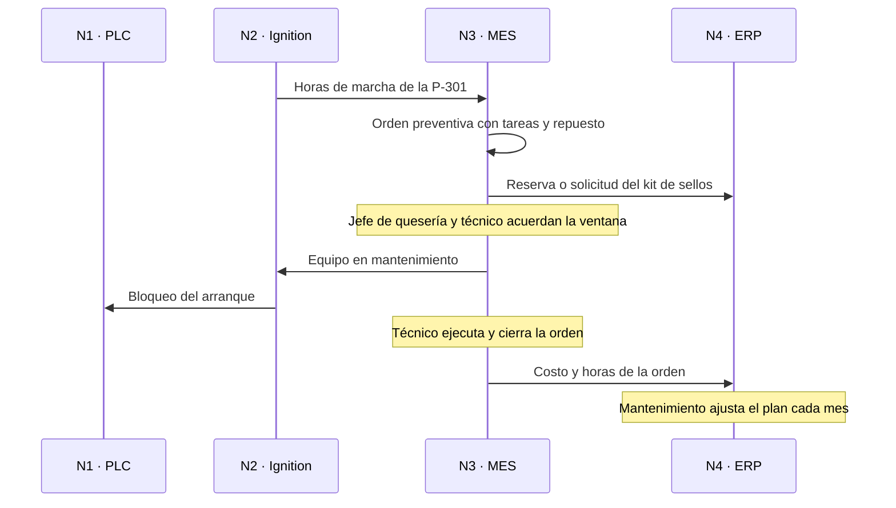

</details>

<details>
<summary><b>F7. Recepción de la leche y despacho del producto</b></summary>

**Qué lo dispara:** Llega un carrotanque de la ruta de Carmen de Carupa; en la tarde se despacha un pedido de la cadena. **Actividad de ISA-95:** Gestión de la ejecución y seguimiento (inventarios).

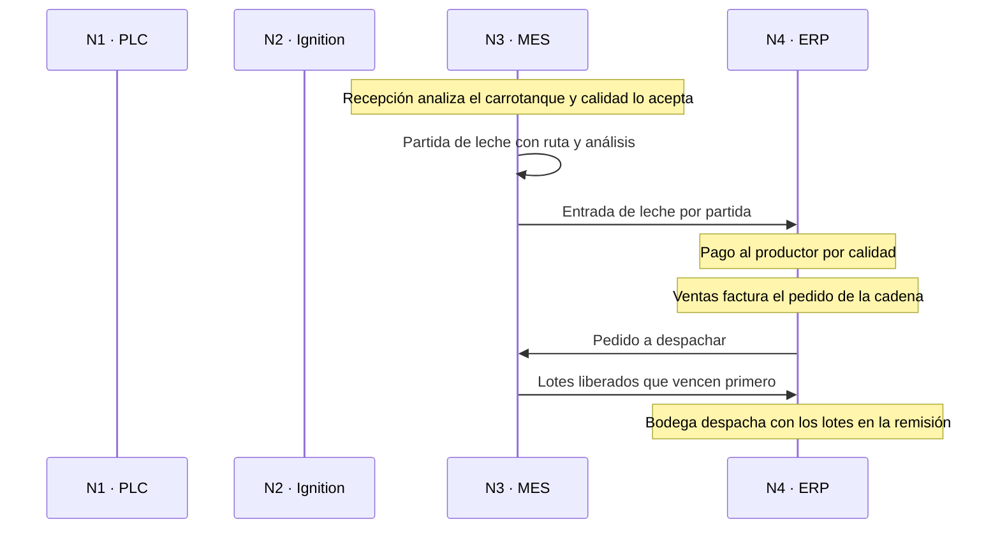

</details>

<details>
<summary><b>F8. Cierre del turno y cierre del mes</b></summary>

**Qué lo dispara:** Termina un turno; termina un mes. **Actividad de ISA-95:** Análisis de desempeño (producción, calidad, mantenimiento e inventarios).

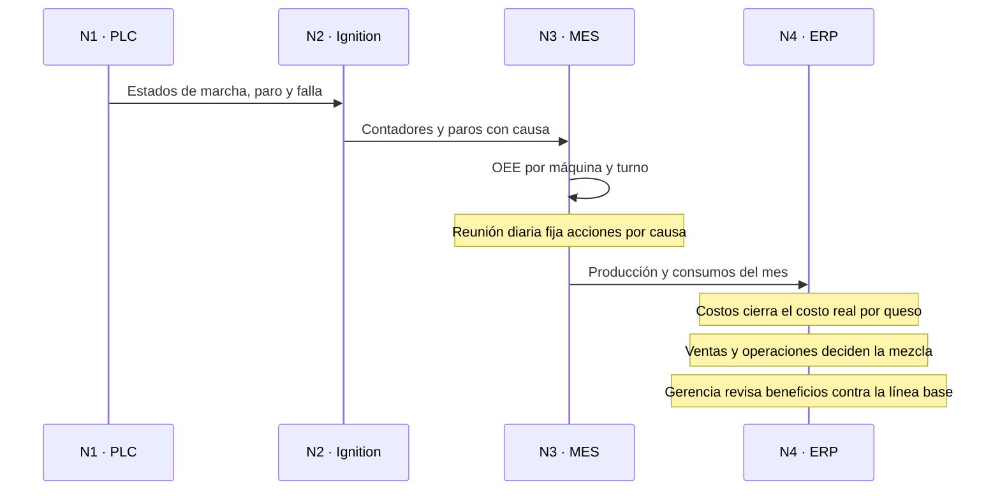

</details>

**Excepciones: equipos**

<details>
<summary><b>E1. Falla del variador de las liras durante el corte</b></summary>

**Qué lo dispara:** El variador SC-301 (PowerFlex 525) de las liras de la tina TQ-301 se dispara por sobrecorriente en plena fase de corte de un lote de campesino. **Actividad de ISA-95:** Gestión de la ejecución y de recursos (producción y mantenimiento).

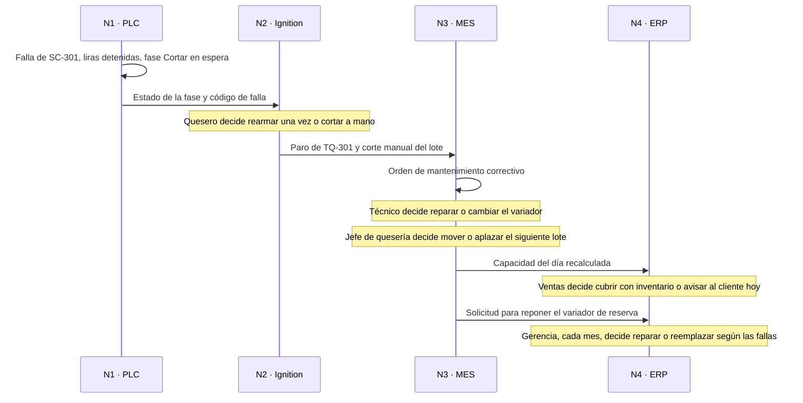

</details>

<details>
<summary><b>E2. Falla o deriva de un instrumento</b></summary>

**Qué lo dispara:** La sonda TT-301 de la tina entrega una señal fuera de rango (menos de 3,8 mA) mientras se calienta la leche. **Actividad de ISA-95:** Gestión de la ejecución (producción y mantenimiento).

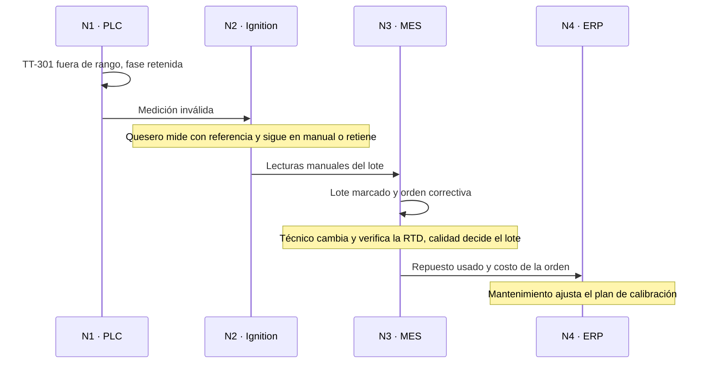

</details>

<details>
<summary><b>E3. Falla de un servicio: el vapor</b></summary>

**Qué lo dispara:** La caldera se dispara y cae la presión de vapor mientras se pasteuriza y se calientan las tinas. **Actividad de ISA-95:** Gestión de la ejecución (producción y mantenimiento).

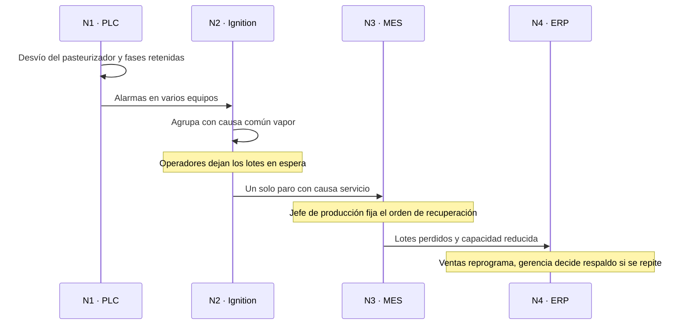

</details>

**Excepciones: materiales**

<details>
<summary><b>E4. Falta de cuajo para un lote</b></summary>

**Qué lo dispara:** Al despachar el lote de mozzarella, el MES no puede reservar el cuajo: el inventario no alcanza para la dosis de la receta o la única partida disponible está vencida. **Actividad de ISA-95:** Gestión de recursos (inventarios).

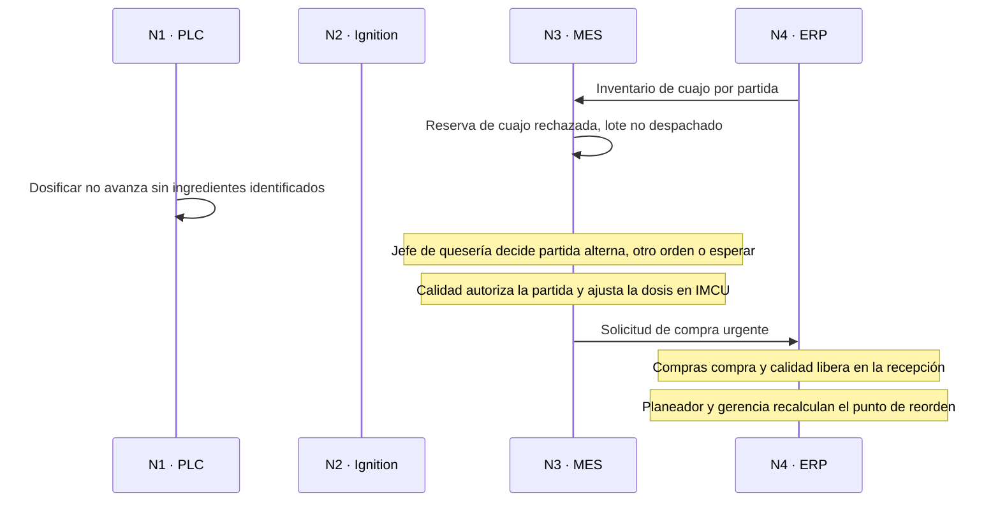

</details>

<details>
<summary><b>E5. Leche cruda rechazada en la recepción</b></summary>

**Qué lo dispara:** La prueba de antibióticos de un carrotanque de 4.000 L sale positiva. **Actividad de ISA-95:** Gestión de la ejecución (calidad e inventarios).

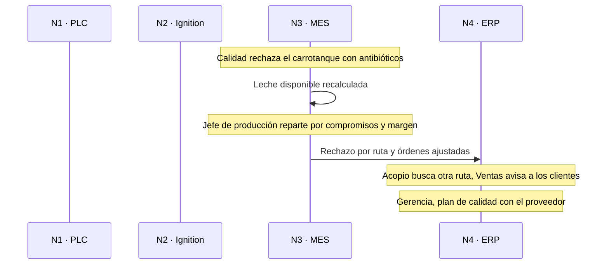

</details>

<details>
<summary><b>E6. Empaque defectuoso de un proveedor</b></summary>

**Qué lo dispara:** La termoformadora empieza a rechazar unidades por vacío insuficiente al cambiar a un rollo nuevo de película. **Actividad de ISA-95:** Recolección de datos y análisis de desempeño (calidad e inventarios).

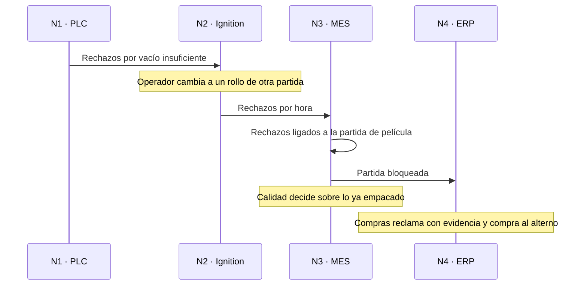

</details>

**Excepciones: proceso y calidad**

<details>
<summary><b>E7. Temperatura de pasteurización por debajo del límite</b></summary>

**Qué lo dispara:** La sonda del tubo de retención del pasteurizador (operación 1.4.1) baja de 72 °C mientras pasa la leche para los quesos. **Actividad de ISA-95:** Gestión de la ejecución y seguimiento (calidad).

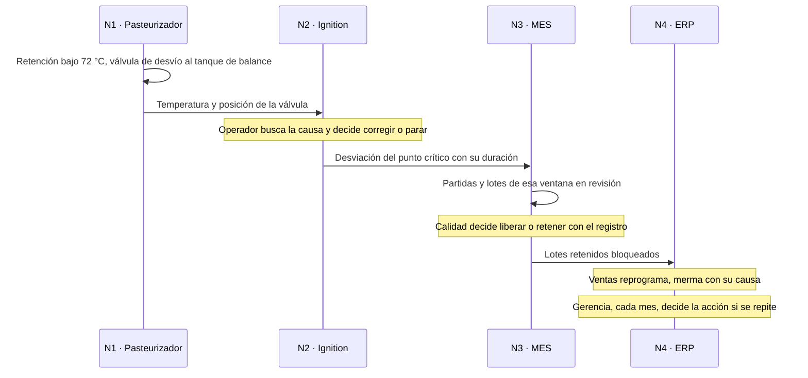

</details>

<details>
<summary><b>E8. Lote con rendimiento fuera de la banda</b></summary>

**Qué lo dispara:** Al cerrar un lote de mozzarella, su rendimiento real queda por debajo de la banda que fijó la línea base frente al rendimiento teórico de Van Slyke. **Actividad de ISA-95:** Análisis de desempeño (producción y calidad).

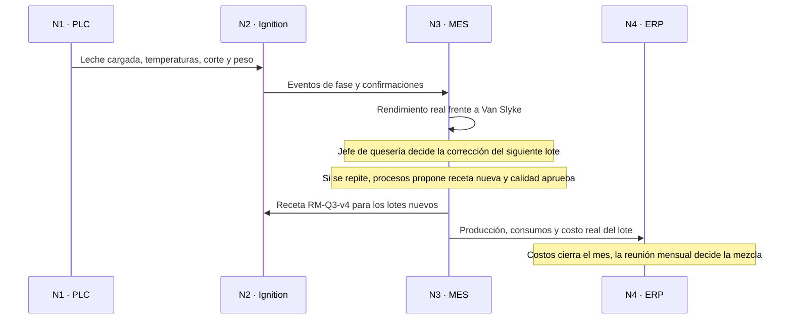

</details>

<details>
<summary><b>E9. Metal detectado en la estación E18</b></summary>

**Qué lo dispara:** El detector de metales de la E18 expulsa dos unidades de doble crema en diez minutos. **Actividad de ISA-95:** Gestión de la ejecución y seguimiento (calidad).

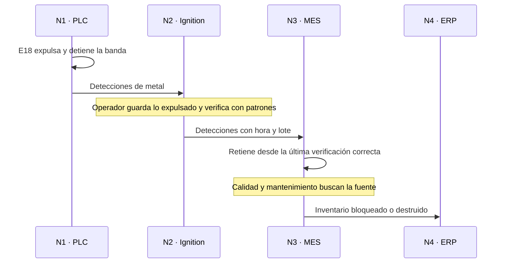

</details>

<details>
<summary><b>E10. Unidades fuera de peso en la estación E18</b></summary>

**Qué lo dispara:** El peso promedio de las unidades de 500 g de campesino baja turno a turno y empiezan los rechazos por bajo peso. **Actividad de ISA-95:** Gestión de la ejecución y análisis de desempeño (calidad).

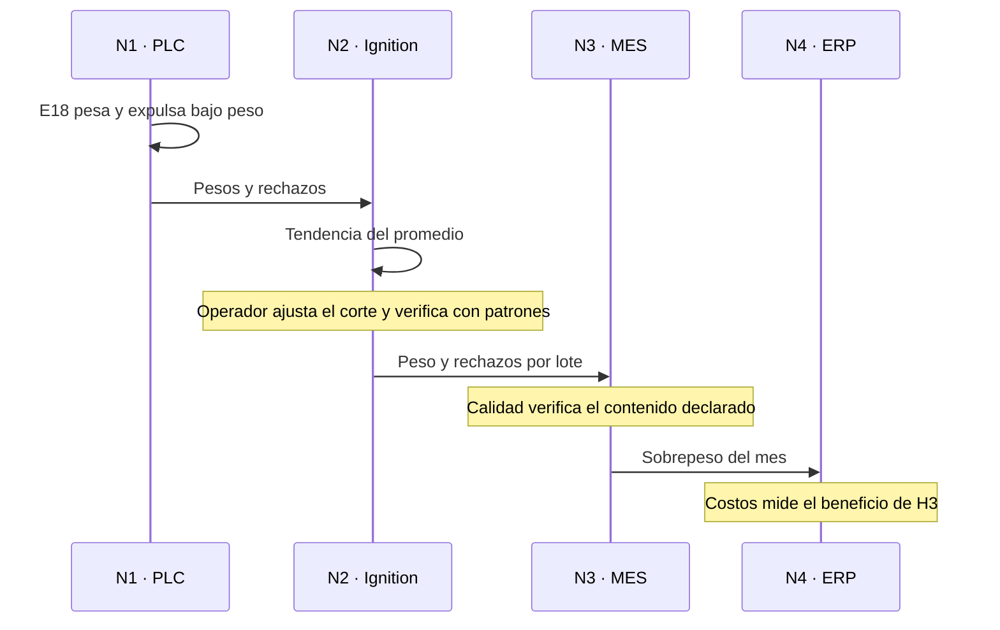

</details>

<details>
<summary><b>E11. Queja de un cliente o retiro de producto</b></summary>

**Qué lo dispara:** La cadena reporta un empaque de doble crema con un cuerpo extraño e informa el lote impreso. **Actividad de ISA-95:** Seguimiento y análisis de desempeño (calidad).

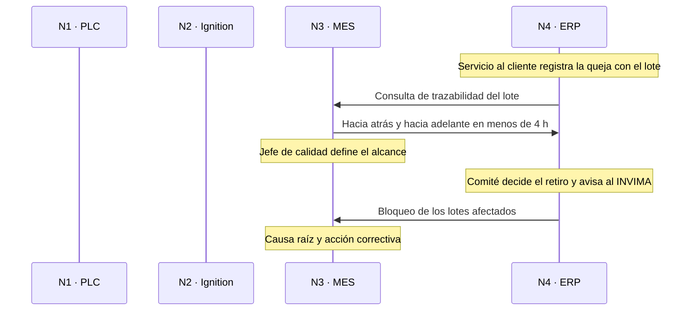

</details>

**Excepciones: personal**

<details>
<summary><b>E12. Falta el quesero de un turno</b></summary>

**Qué lo dispara:** El quesero del turno de la mañana avisa una incapacidad de tres días. **Actividad de ISA-95:** Gestión de recursos (producción).

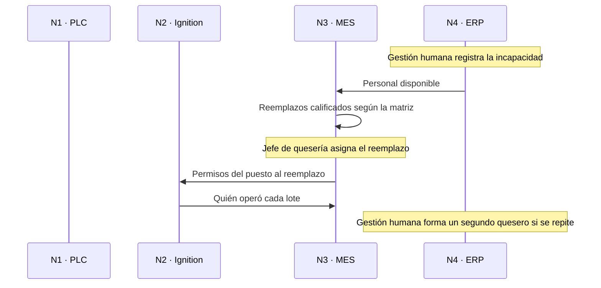

</details>

**Excepciones: demanda**

<details>
<summary><b>E13. Pedido urgente de doble crema</b></summary>

**Qué lo dispara:** Una cadena pide 100 kg adicionales de doble crema para entregar dentro de dos días. **Actividad de ISA-95:** Programación detallada (producción e inventarios).

```mermaid
sequenceDiagram
  participant PLC as N1 · PLC
  participant SC as N2 · Ignition
  participant MES as N3 · MES
  participant ERP as N4 · ERP
  Note over ERP: Ventas registra el pedido de 100 kg de doble crema
  MES->>ERP: Capacidad publicada de tinas e hiladora
  Note over ERP: Planeador mueve 375 L diarios del campesino al doble crema
  Note over ERP: Gerente comercial decide aceptar con su margen
  ERP->>MES: Órdenes de producción ajustadas
  Note over MES: Jefe de quesería despacha los lotes, calidad programa el muestreo
  MES->>SC: Lote TQ-302 de 3.375 L con RM-Q2
  SC->>PLC: Solicitud de ejecución
  PLC->>SC: Fases cumplidas
  SC->>MES: Eventos y cantidades
  MES->>ERP: Producción liberada
  Note over ERP: Ventas despacha y factura
```

</details>

<details>
<summary><b>E14. Cancelación de un pedido con producto que vence</b></summary>

**Qué lo dispara:** Un cliente mayorista cancela 200 kg de campesino, que vence en 15 a 20 días. **Actividad de ISA-95:** Programación detallada (inventarios y producción).

```mermaid
sequenceDiagram
  participant PLC as N1 · PLC
  participant SC as N2 · Ignition
  participant MES as N3 · MES
  participant ERP as N4 · ERP
  Note over ERP: Ventas registra la cancelación
  ERP->>ERP: Campesino sin destino con su vencimiento
  Note over ERP: Planeador decide reasignar, vender con descuento o producir menos
  ERP->>MES: Órdenes ajustadas
  MES->>MES: Menos campesino, más doble crema dentro de límites
  Note over ERP: Comercial revisa la cláusula de cancelación
```

</details>

<details>
<summary><b>E15. Llega más o menos leche de la planeada</b></summary>

**Qué lo dispara:** Por las lluvias, el acopio del día llega con 1.500 L menos de lo planeado (o, en verano, con 2.000 L más). **Actividad de ISA-95:** Programación detallada (inventarios y producción).

```mermaid
sequenceDiagram
  participant PLC as N1 · PLC
  participant SC as N2 · Ignition
  participant MES as N3 · MES
  participant ERP as N4 · ERP
  Note over MES: Recepción registra la leche real del día
  MES->>MES: Mezcla del día por programación lineal
  Note over MES: Jefe de producción y planeador aprueban el reparto
  MES->>ERP: Órdenes ajustadas a la leche real
  Note over ERP: Si sobra, se vende cruda antes de producir sin venta
  Note over ERP: Acopio y gerencia revisan la estacionalidad
```

</details>

**Excepciones: información**

<details>
<summary><b>E16. Caída del enlace con el MES y el ERP</b></summary>

**Qué lo dispara:** El servidor del MES (SRV-01) o la red entre la planta y el ERP dejan de responder durante el turno. **Actividad de ISA-95:** Recolección de datos (todas).

```mermaid
sequenceDiagram
  participant PLC as N1 · PLC
  participant SC as N2 · Ignition
  participant MES as N3 · MES
  participant ERP as N4 · ERP
  Note over MES: Servidor o red fuera de servicio
  PLC->>PLC: Fases en curso terminan con enclavamientos locales
  PLC->>SC: Estados y mediciones
  SC->>SC: Historiador guarda en disco local
  Note over SC: Jefe de quesería decide terminar lotes y pasar a papel
  Note over ERP: Capacidad marcada sin actualizar, Ventas no promete
  Note over MES: Sistemas restablece el servicio
  SC->>MES: Eventos guardados, sin duplicados
  Note over MES: Papel cargado en 24 h, calidad libera esos lotes
  MES->>ERP: Consumos y producción pendientes
```

</details>

<details>
<summary><b>E17. Dato inconsistente entre el MES y el ERP</b></summary>

**Qué lo dispara:** El ERP rechaza un reporte de consumo de cultivo porque dejaría el inventario en negativo. **Actividad de ISA-95:** Recolección de datos y seguimiento (inventarios).

```mermaid
sequenceDiagram
  participant PLC as N1 · PLC
  participant SC as N2 · Ignition
  participant MES as N3 · MES
  participant ERP as N4 · ERP
  MES->>ERP: Consumo de cultivo del lote
  ERP->>MES: Rechazo, inventario insuficiente
  MES->>MES: Mensaje guardado en error
  Note over MES: Usuario clave busca la causa
  Note over ERP: Bodega cuenta y registra la recepción faltante
  MES->>ERP: Reenvío con el mismo identificador
  Note over ERP: Costos revisa los errores del mes
```

</details>

<details>
<summary><b>E18. Acceso no autorizado a la red de planta</b></summary>

**Qué lo dispara:** El firewall FW-01 detecta un intento de conexión desde la red de oficinas al servidor del SCADA. **Actividad de ISA-95:** Gestión de recursos (sistemas) (todas).

```mermaid
sequenceDiagram
  participant PLC as N1 · PLC
  participant SC as N2 · Ignition
  participant MES as N3 · MES
  participant ERP as N4 · ERP
  Note over MES: Firewall bloquea el acceso y avisa a sistemas
  Note over MES: Sistemas aísla la red de planta
  PLC->>PLC: Sigue con su lógica local
  PLC->>SC: Estados y mediciones dentro de la planta
  Note over SC: Jefe de quesería pasa al respaldo manual si hace falta
  Note over MES: Sistemas revisa, cambia claves y reconecta
  MES->>ERP: Datos pendientes al reconectar
  Note over ERP: Gerencia aprueba mejoras de seguridad
```

</details>

**Excepciones: seguridad**

<details>
<summary><b>E19. Paro de emergencia o accidente en el hilado</b></summary>

**Qué lo dispara:** Un operario se quema con agua del hilado y su compañero oprime el paro de emergencia de la hiladora. **Actividad de ISA-95:** Gestión de la ejecución (producción).

```mermaid
sequenceDiagram
  participant PLC as N1 · PLC
  participant SC as N2 · Ignition
  participant MES as N3 · MES
  participant ERP as N4 · ERP
  PLC->>PLC: Paro por el circuito de seguridad
  PLC->>SC: Evento de paro de emergencia
  Note over SC: Brigada atiende y asegura el área
  SC->>MES: Paro con causa seguridad
  Note over MES: Jefe de producción decide reanudar y el lote
  Note over MES: Seguridad y salud reporta e investiga
  MES->>ERP: Costo del paro y del accidente
  Note over ERP: Gerencia aprueba acciones correctivas
```

</details>

| Función de ISA-95 | ERP (nivel 4) | MES (nivel 3) | Casos |
|---|---|---|---|
| 1.0 Procesamiento de pedidos | Pedidos, contrato de la cadena, promesa con la capacidad publicada | Publica la capacidad disponible | F7, E13, E14 |
| 2.0 Programación de la producción | Plan semanal y órdenes por queso y fecha | Programa detallado del día por tina, hiladora y CIP | F3, E15 |
| 3.0 Control de la producción | -- | Despacho, ejecución, recetas con versión, paros y OEE, con el SCADA y el PLC | F1, F4, F8, E1, E2, E3 |
| 4.0 Control de materiales y energía | Inventario de insumos y punto de reorden | Reserva por lote, consumo real, partida de leche | F7, E4, E5, E17 |
| 5.0 Compras | Solicitud, aprobación por monto, orden de compra y recepción | Crea la solicitud desde la orden de mantenimiento o la reserva fallida | F6, E1, E4, E6 |
| 6.0 Aseguramiento de calidad | Especificación del producto, bloqueo de inventario, certificado al cliente | Muestreo, resultados, liberación y trazabilidad por lote | F5, E7, E8, E9, E10, E11 |
| 7.0 Inventario de producto | Disponible, vencimientos y despachos | Lotes liberados y salida de lo que vence primero | F7, E14 |
| 8.0 Costos | Costo real por lote y por queso, merma por causa | Consumos y horas reales de cada lote | F8, E8 |
| 9.0 Despachos | Remisión y factura con los lotes | -- | F7 |
| 10.0 Mantenimiento | Costo de repuestos y órdenes, tiempo medio entre fallas para la gerencia | Órdenes preventivas y correctivas, contador de horas, registro de fallas | F6, E1, E2, E3 |
| Ingeniería y desarrollo | Lista de materiales del producto | Receta maestra con su versión, aprobada por calidad | F1, E8 |
| Gestión humana (fuera del modelo) | Nómina, novedades y matriz de competencias | Asignación por puesto y horas por lote | F2, E12 |
